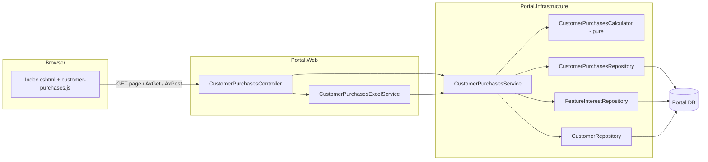
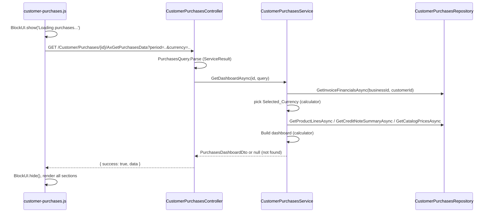

# Design Document

## Overview

The Customer Purchases Dashboard is a per-customer page served at `/Customer/Purchases/{id}`. It shows what a customer buys, how that changes over time, and what is still unpaid. The approved layout is `.kiro/docs/mockups/customer-purchases-dashboard.html`. Where the mockup's sample behaviour and `requirements.md` differ, `requirements.md` wins (see Requirement Alignment Notes).

The design follows the Portal's standing architecture: `Controller -> Service -> Repository -> SQL Server`, raw parameterised SQL, full table names with no table aliases, and vanilla `fetch` on the client with `BlockUI` and SweetAlert2.

Key design decisions:

1. **One data read, one calculator.** The repository returns raw per-invoice rows (total, valid payments, applied credit, last payment date). A pure static `CustomerPurchasesCalculator` derives every KPI, the pending table, the chart, the mix and the behaviour insights from those rows. The pending-invoices KPI and the pending table footer therefore come from the same list and cannot disagree (Requirement 19.7, 19.8). The calculator is also what the property-based tests target.
2. **One DTO, two delivery paths.** `PurchasesDashboardDto` is embedded as JSON in the initial page (one server round trip, Requirement 20.1) and returned unchanged by `AxGetPurchasesData` for period and currency refreshes. A single client render path draws both.
3. **Derived, not persisted, overdue; written-off excluded.** The calculator never receives `InvoiceFinancialStatusTypeId`. The repository reduces it to one flag, `IsWrittenOff` (status 5), which is the only persisted-status information the calculator sees. Overdue is `NOT IsWrittenOff AND OutstandingBalance > 0 AND DueDate < today (UTC)` and Pending is `NOT IsWrittenOff AND OutstandingBalance > 0` (Requirements 8.4, 8.7, 19.7; `.kiro/steering/financial-conventions.md`). Overdue (4) and every other persisted value cannot influence any figure.
4. **KPI collapse state is read server-side.** The `cp_kpi_collapsed` cookie is parsed in C# and applied to the Razor markup, so cards never flash in the wrong state (Requirement 9.9). JavaScript only writes the cookie.
5. **Dedicated controller.** `CustomerPurchasesController` uses attribute routes under `/Customer/Purchases/...` and carries the same `[Authorize]` and `[ModuleAccess(PortalModules.Customer)]` as `CustomerController`, so access is denied the same way (Requirement 2.2, 2.3). `CustomerController` has no `Purchases` action, so the conventional route `{controller=Home}/{action=Index}/{id?}` in `Program.cs` does not conflict.

### Research summary: existing code this design reuses

| Area | What exists (verified in the repo) | How the design uses it |
|------|------------------------------------|------------------------|
| Customers list | `Portal.Web/Views/Customer/Index.cshtml` line 118-119 renders `<a ... class="tbl-action tbl-action--primary">Edit</a>` and `<a href="/Statement?customerId=@customer.Id" class="tbl-action tbl-action--primary">Statement</a>`, then the Deactivate form for active customers. | Add the Purchases anchor directly after Statement, outside the `@if (customer.IsActive)` block. |
| Module access | `CustomerController` is `[Authorize]` + `[ModuleAccess(PortalModules.Customer)]`. `ModuleAccessAttribute` (`Portal.Web/Security`) is an `IAsyncAuthorizationFilter` that checks subscription, plan and user permission; the default level is `AccessLevels.ReadOnly`. | Same two attributes on the new controller. |
| Tenant | `ICurrentTenantService.CurrentBusinessId` (`Portal.Infrastructure/Services/ICurrentTenantService.cs`) returns 0 when no business is found. | Service passes it to every repository call; `<= 0` short-circuits to "not found" / empty. |
| Customer lookup | `CustomerRepository.GetByIdAndBusinessIdAsync(id, businessId)` (used by `CustomerService.GetCustomerByIdAsync`). | The service uses it for the tenant check before any purchase query. |
| Outstanding balance | `FinancialStatusEngine.ComputeOutstandingBalance(decimal totalAmount, IEnumerable<Payment> payments, decimal appliedCreditTotal)` = `total - sum(payments where !IsVoided) - appliedCredit`. | The calculator uses identical arithmetic; a conformance property proves equality. |
| Valid payments | `PaymentRepository.GetValidPaymentsByInvoiceIdAsync`: `IsVoided = 0 AND PaymentDateUtc <= GETUTCDATE()` (future-dated payments excluded; see `.kiro/specs/future-dated-payments`). `DashboardService.GetKpiDataAsync` uses the same predicate. `ReceivablesQueryService` omits the date predicate (see notes). | Same predicate as the engine and the dashboard. |
| Applied credit | `CreditNoteRepository.GetTotalAppliedCreditAsync`: `SUM([credit].[CreditNoteApplication].[AmountApplied])` joined to `[credit].[CreditNote]` on `CreditNoteId`, with `[credit].[CreditNote].[BusinessId] = @BusinessId AND [credit].[CreditNoteApplication].[IsVoided] = 0`. | Same join, as correlated subqueries (the `ReceivablesQueryService.GetReceivablesAsync` pattern). |
| Parent/child payments | `[revenue].[Payment].[ParentPaymentId]`; customer-level parent payments have `InvoiceId = NULL`, child allocations carry the `InvoiceId` (migration `120_AddGlobalPaymentColumns.sql`). | Summing by `InvoiceId` counts only per-invoice settlements and never double-counts a parent. |
| Invoice status ids | `[invoice].[InvoiceStatusType]`: Draft (1), Issued (2), Cancelled (3) (migration 008). Soft delete column: `[invoice].[Invoice].[IsDeleted]` (migration 043). Payment date column: `[revenue].[Payment].[PaymentDateUtc]`. | Counted_Invoice predicate `IsDeleted = 0 AND InvoiceStatusTypeId <> @Draft AND <> @Cancelled`. |
| Credit note statuses | `[credit].[CreditNoteStatusType]`: Draft (1), Issued (2), Applied (3), Voided (4) (migration 063). | "Counted" credit notes are Issued (2) and Applied (3) only; Draft (1) and Voided (4) are excluded (Requirement 14.13). |
| Repository base | `GenericStoredProcedureRepository<T>` (`Portal.Infrastructure/Repositories`). `UserPracticeFocusRepository` (`Repositories/Sales`) is the closest "write + read table repository" example; `CreditNoteRepository.GetTotalAppliedCreditAsync` is the `DbConnection` command/reader example with transaction enlistment. | Same shapes. |
| ServiceResult | `ServiceResult` and `ServiceResult<T>` (`Portal.Infrastructure/Models/ServiceResult.cs`) with `Ok`, `Ok(data)`, `Fail(message)`. | Used for query validation and interest registration. |
| Logging | `SystemLoggerExtensions` **does not exist** in this repository. Controllers log through `ILogger<T>` (for example `InvoiceController` uses `_logger.LogError(ex, ...)`); Serilog writes to the logging database. | Use `ILogger<CustomerPurchasesController>` (see notes). |
| BlockUI | `Portal.Web/wwwroot/js/block-ui.js` (`BlockUI.show(message)`, `BlockUI.hide()`), loaded globally in `_Layout.cshtml`; SweetAlert2 is loaded in `_Layout.cshtml` too. `wwwroot/js/sales/products.js` is the reference fetch pattern (show, fetch, hide, then `Swal.fire` with `confirmButtonColor: '#0D5EA6'`). | Same pattern in `customer-purchases.js`. |
| Antiforgery | Each page that posts renders `@Html.AntiForgeryToken()` and defines `getAntiForgeryToken()` reading `input[name="__RequestVerificationToken"]`; JSON posts send it as the `RequestVerificationToken` header (`sales/products.js`). | Same. |
| Excel | `Portal.Web/Services/InvoiceExcelService.cs` (ClosedXML `XLWorkbook`, `Style.NumberFormat.Format`, `workbook.SaveAs(stream)`, catch `ex` -> `_logger.LogError` -> `throw;`); `InvoiceController` returns `File(bytes, "application/vnd.openxmlformats-officedocument.spreadsheetml.sheet", filename)` and a JSON 500 on failure. | `CustomerPurchasesExcelService` follows it. |
| DI | `Program.cs` registers repositories as `builder.Services.AddScoped<XRepository>(sp => new XRepository(sp.GetRequiredService<PortalDbContext>()))` and services as `AddScoped<IX, X>()`. `CreditNoteRepository`, `CustomerRepository` are already registered. `TimeProvider.System` is used directly for `InstalmentStatusEngine`. | Same registrations. |
| Catalogue | `[product].[Product]` has `ProductCode`, `DefaultSellingPrice`, `DefaultCostPrice`, `IsActive`, unique `(BusinessId, ProductCode)` (migration 052). **There is no currency column** and no per-currency price. `[product].[ProductPriceTier]` holds tier prices, also without currency. | Fallback specified in Data Models. |
| Indexes | `[invoice].[Invoice]`: `IX_Invoice_BusinessId`, `IX_Invoice_BusinessId_IsDeleted`, `UX_Invoice_QuotationId`, `IX_Invoice_VatSubmissionPeriodId`, `UX_Invoice_BusinessId_InvoiceNumber`. **No** `(BusinessId, CustomerId, InvoiceDate)` index. `[invoice].[InvoiceLine]`: only the primary key and the filtered `UX_InvoiceLine_AdjustmentLine`; **no** `InvoiceId` index. `[revenue].[Payment]`: `IX_Payment_BusinessId`, `IX_Payment_ParentPaymentId`, `IX_Payment_CustomerId`; **no** `InvoiceId` index. `[credit].[CreditNoteApplication]` already has `IX_CreditNoteApplication_InvoiceId`; `[credit].[CreditNote]` has `IX_CreditNote_BusinessId_CustomerId`. | Migration adds the missing indexes (Requirement 20.4, 20.5) plus a payment index. |
| Migrations | `Portal.Database/Migrations/NNN_Name.sql`, three-digit sequence, latest is `232_AddUniqueInvoiceNumberPerBusiness.sql`, so the next numbers are **233** and **234**. Scripts are idempotent, begin with a comment block, then `USE [Portal]` and `GO` (for example `227_CreateUserPracticeFocus.sql`). `FullSchema_Deploy.sql` does not contain recent tables (no `UserPracticeFocus`), so it is not maintained per migration and is left alone. | Two new scripts. |
| EF mapping | The project is SQL-script-first with hand-maintained entities and `ConfigureX(ModelBuilder)` methods in `PortalDbContext.cs` (for example `ConfigureUserPracticeFocus`, entity in `Entities/Sales/UserPracticeFocus.cs`), plus a `HasQueryFilter(e => e.BusinessId == _currentTenantService.CurrentBusinessId)` entry in `ApplyGlobalQueryFilters`. There is no scaffold command to run. | Hand-written `FeatureInterest` entity and `ConfigureFeatureInterest`. |
| Test stack | `Portal.Tests` (net8.0): xunit 2.9.2, **FsCheck 2.16.6 + FsCheck.Xunit 2.16.6**, Moq 4.20.72, `Microsoft.EntityFrameworkCore.InMemory`, `Xunit.SkippableFact`. Property tests live in `Portal.Tests/PropertyBased` and use `[Property]` with a `// Feature: ..., Property N` header comment (for example `FinancialStatusEnginePropertyTests`). | Same library and layout. |

## Architecture



Layer rules enforced by the structure:

- The controller holds HTTP concerns only: binding, antiforgery, the user id claim, status codes, JSON shaping. It holds no repository reference and no monetary arithmetic (Requirement 19.1).
- The service holds no `DbContext`, connection or SQL text (Requirement 19.2). It orchestrates repository calls and calls the calculator.
- The calculator is a static class of pure functions. `today` is always a parameter, taken from an injected `TimeProvider` in the service.
- The repository holds all SQL.

### Request flow for a period or currency refresh



## Components and Interfaces

### File list

**Database (`Portal.Database/Migrations`)**

- `233_CreateInsightSchemaAndFeatureInterest.sql`: `[insight]` schema, `[insight].[FeatureInterest]`, unique index.
- `234_AddCustomerPurchasesIndexes.sql`: `IX_Invoice_BusinessId_CustomerId_InvoiceDate`, `IX_InvoiceLine_InvoiceId`, `IX_Payment_InvoiceId`.

**Portal.Infrastructure**

- `Entities/Insight/FeatureInterest.cs`
- `Data/PortalDbContext.cs`: add `DbSet<FeatureInterest> FeatureInterests`, `ConfigureFeatureInterest`, and a query filter entry.
- `Repositories/CustomerPurchasesRepository.cs`
- `Repositories/Insight/FeatureInterestRepository.cs`
- `Services/ICustomerPurchasesService.cs`, `Services/CustomerPurchasesService.cs`
- `Services/CustomerPurchases/CustomerPurchasesCalculator.cs` (pure functions; may be split into partial files per area: `.Kpis.cs`, `.Products.cs`, `.Behaviour.cs`, `.Invoices.cs`)
- `Models/CustomerPurchases/PurchasesQuery.cs`, `PurchasesDashboardDto.cs` (and nested DTOs), `PurchasesRows.cs` (repository row types), `PurchasesFeatureKeys.cs`

**Portal.Web**

- `Controllers/CustomerPurchasesController.cs`
- `Services/ICustomerPurchasesExcelService.cs`, `Services/CustomerPurchasesExcelService.cs`
- `Models/CustomerPurchasesPageViewModel.cs`, `Models/KpiCollapseCookie.cs`, `Models/RegisterFeatureInterestRequest.cs`
- `Views/CustomerPurchases/Index.cshtml`
- `Views/Customer/Index.cshtml`: add the Purchases button.
- `wwwroot/js/customer-purchases.js`
- `wwwroot/css/customer-purchases.css` (linked from the view's `Head` section; the shared tokens `.glass`, `.card-pad`, `.topbar`, `.eyebrow`, `.tbl-action` already live in `site.css`)
- `Program.cs`: registrations.

**Portal.Tests**

- `PropertyBased/CustomerPurchases*PropertyTests.cs`, `Unit/Services/CustomerPurchasesServiceTests.cs`, `Unit/Controllers/CustomerPurchasesControllerTests.cs`, `Integration/CustomerPurchasesRepositorySqlTests.cs`.

### Status constants and test access

- Credit note statuses are Draft 1, Issued 2, Applied 3, Voided 4. SQL 3 receives Issued and Applied as `@StatusIssued` and `@StatusApplied` parameters (values 2 and 3), so Draft and Voided credit notes are never counted. Invoice statuses are passed as `@StatusDraft` (1) and `@StatusCancelled` (3); the write-off status 5 is a named constant used only in the `[IsWrittenOff]` expression of SQL 1.
- Each repository exposes its SQL text as an `internal const string` (for example `CustomerPurchasesRepository.InvoiceFinancialsSql`) so tests can scan it for quotation tables and aliases. The implementer must first check `Portal.Infrastructure` for an existing `InternalsVisibleTo("Portal.Tests")` attribute (in the `.csproj` as `<InternalsVisibleTo Include="Portal.Tests" />` or in an `AssemblyInfo.cs`). If one exists, keep the constants `internal`. If none exists, add `<InternalsVisibleTo Include="Portal.Tests" />` to `Portal.Infrastructure.csproj`. Only if that is not acceptable, make the constants `public`.

### Routes and endpoints

| Purpose | Verb and route | Action | Notes |
|---------|----------------|--------|-------|
| Page | `GET /Customer/Purchases/{id:int}?period=&from=&to=&currency=` | `Index` | Renders the shell and embeds the initial `PurchasesDashboardDto` as JSON. Invalid `period`/`from`/`to` fall back to `last12m` and set a warning flag (Requirement 4.13). A `currency` that is malformed or not one of the customer's currencies is ignored (treated as auto) with no warning (Requirement 4.11). |
| Period / currency refresh | `GET /Customer/Purchases/{id:int}/AxGetPurchasesData?period=&from=&to=&currency=` | `AxGetPurchasesData` | Returns `{ success, data: PurchasesDashboardDto }`. Omit `currency` after a period change so the default is re-picked (Requirement 5.3); send it when the user clicks the currency switch. |
| Drill-down | `GET /Customer/Purchases/{id:int}/AxGetProductPurchaseLines?period=&from=&to=&currency=&productKey=` | `AxGetProductPurchaseLines` | Returns `{ success, data: ProductPurchaseLinesDto }`. |
| Interest | `POST /Customer/Purchases/AxPostRegisterFeatureInterest` | `AxPostRegisterFeatureInterest` | JSON body `{ "featureKey": "discounts" }`, `[ValidateAntiForgeryToken]`. No customer id in this request, so Requirement 2.7 does not apply to it; it is scoped by business and user. |
| Export | `GET /Customer/Purchases/{id:int}/AxGetExportPurchases?period=&from=&to=&currency=` | `AxGetExportPurchases` | Returns the `.xlsx` file. A missing or other-tenant customer returns the same shared `NotFound()` as every other action (Requirement 2.6, 2.7, 17.12). Only an exception returns status 500 JSON `{ success:false, kind:"error", message:<constant> }`. The client calls it with `fetch`, so it carries the `Ax` prefix and BlockUI wraps it (Requirement 17.10). |

Every Ajax method name starts with `AxGet` or `AxPost` (Requirement 2.8). The not-found result is the single expression `NotFound()` used by the page and by all Ajax actions, so status, body and headers are identical for a missing customer and a customer owned by another business (Requirement 2.6, 2.7).

### Controller

```csharp
[Authorize]
[ModuleAccess(PortalModules.Customer)]
public class CustomerPurchasesController : Controller
{
    private readonly ICustomerPurchasesService _service;
    private readonly ICustomerPurchasesExcelService _excelService;
    private readonly ILogger<CustomerPurchasesController> _logger;

    [HttpGet("Customer/Purchases/{id:int}")]
    public async Task<IActionResult> Index(int id, string? period, string? from, string? to, string? currency)
    {
        // Period problems fall back to last12m with a warning; a bad currency is silently treated as "auto".
        var parsed = PurchasesQuery.Parse(period, from, to, currency: null);
        var safeCurrency = PurchasesQuery.NormalizeCurrency(currency);   // null unless ^[A-Z]{3}$
        var query = (parsed.Success ? parsed.Data! : PurchasesQuery.Default) with { Currency = safeCurrency };
        var dto = await _service.GetDashboardAsync(id, query);          // null => not found
        if (dto is null) return NotFound();

        var userId = User.FindFirstValue(ClaimTypes.NameIdentifier);
        var vm = new CustomerPurchasesPageViewModel
        {
            Dashboard = dto,
            CollapsedKpiIds = KpiCollapseCookie.Parse(Request.Cookies[KpiCollapseCookie.Name]),
            RegisteredFeatureKeys = userId is null ? new() : await _service.GetRegisteredFeatureKeysAsync(userId),
            ShowPeriodFallbackWarning = !parsed.Success && (period != null || from != null || to != null)
        };
        return View(vm);
    }
    // AxGetPurchasesData, AxGetProductPurchaseLines, AxGetExportPurchases, AxPostRegisterFeatureInterest below.
}
```

Behaviour of the Ajax actions:

- Each parses input with `PurchasesQuery.Parse` (a `ServiceResult<PurchasesQuery>`). A failed parse returns `Json(new { success = false, kind = "validation", message })` with status 400.
- Each wraps the service call in `try { ... } catch (Exception ex) { _logger.LogError(ex, "..."); return StatusCode(500, new { success = false, kind = "error", message = "Failed to load purchases. Please try again." }); }`. The message is a constant string; the exception text never reaches the response (Requirement 18.3, 18.8).
- `AxGetExportPurchases` calls `_excelService.GenerateAsync`. A `null` result (customer missing or in another business) returns the same shared `NotFound()` as the page and the other Ajax actions, never a JSON failure body. A successful result returns `File(bytes, "application/vnd.openxmlformats-officedocument.spreadsheetml.sheet", fileName)`. Only an exception is caught (`catch (Exception ex)`), logged with `_logger.LogError(ex, ...)` and returned as status 500 `{ success:false, kind:"error", message:<constant> }`.
- `AxPostRegisterFeatureInterest` reads the user id from `ClaimTypes.NameIdentifier` (as `SalesController` does). A missing claim returns 403. It calls `_service.RegisterFeatureInterestAsync(userId, request.FeatureKey)` and maps `ServiceResult` to `{ success, kind, message }`; a validation failure is status 400 with `kind = "validation"` so the client shows the `warning` icon (Requirement 15.7). The action stays at the class-level `ReadOnly` access level: registering interest changes no customer data, and a read-only user can still ask to be told about a feature.
- `[ValidateAntiForgeryToken]` on the POST rejects a missing or invalid token before the action body runs, so nothing is written (Requirement 2.9).

### Service interface

```csharp
public interface ICustomerPurchasesService
{
    // null => customer not found for the current tenant (or no tenant)
    Task<PurchasesDashboardDto?> GetDashboardAsync(int customerId, PurchasesQuery query);
    Task<ProductPurchaseLinesDto?> GetProductPurchaseLinesAsync(int customerId, PurchasesQuery query, string productKey);
    Task<List<string>> GetRegisteredFeatureKeysAsync(string userId);
    Task<ServiceResult> RegisterFeatureInterestAsync(string userId, string? featureKey);
}
```

`CustomerPurchasesService` constructor: `CustomerPurchasesRepository`, `FeatureInterestRepository`, `CustomerRepository`, `ICurrentTenantService`, `TimeProvider`.

`GetDashboardAsync` algorithm:

1. `businessId = tenant.CurrentBusinessId`. If `<= 0`, return `null` without touching the database (Requirement 2.5).
2. `customer = customerRepository.GetByIdAndBusinessIdAsync(customerId, businessId)`. If `null`, return `null`.
3. `today = DateOnly.FromDateTime(timeProvider.GetUtcNow().UtcDateTime)`.
4. `invoices = repo.GetInvoiceFinancialsAsync(businessId, customerId)` (all currencies, all time).
5. `currencies = Calculator.DistinctCurrencies(invoices)`; `currency = Calculator.SelectCurrency(invoices, query, today)` (an unknown `query.Currency` is treated as auto).
6. `lines = repo.GetProductLinesAsync(businessId, customerId, currency)`; `credit = repo.GetCreditNoteSummaryAsync(businessId, customerId, currency, periodStart, periodEnd)`; `catalogue = repo.GetCatalogPricesAsync(businessId)`; `catalogueCurrency = repo.GetBusinessPrimaryCurrencyAsync(businessId)` (returns the ISO code or `null`) is passed to the calculator.
7. `Calculator.BuildDashboard(...)` returns the DTO.

Step 6 runs only when `invoices.Count > 0`. All steps are set-based; nothing runs per invoice or per product (Requirement 20.3).

### Query object

```csharp
public sealed record PurchasesQuery(string PeriodKey, DateOnly? From, DateOnly? To, string? Currency)
{
    public static readonly PurchasesQuery Default = new("last12m", null, null, null);
    public static ServiceResult<PurchasesQuery> Parse(string? period, string? from, string? to, string? currency);
    public static string? NormalizeCurrency(string? currency);   // trimmed value if ^[A-Z]{3}$, else null (never throws)
}
```

`Parse` rules:

- `period` null/empty means `last12m`. Otherwise it must be exactly one of `last12m`, `thisYear`, `lastYear`, `all`, `custom` (ordinal, case-sensitive); anything else fails.
- `custom` requires `from` and `to` that parse with `DateOnly.TryParseExact(value, "yyyy-MM-dd", CultureInfo.InvariantCulture, DateTimeStyles.None, ...)` and `from <= to`. For other periods `from`/`to` are ignored.
- `currency` null/empty means "auto". Otherwise it must match `^[A-Z]{3}$` or the parse fails with a validation message. A well-formed code that the customer never used is treated as "auto" by the service, so no information about other data leaks.

### Calculator (pure)

`CustomerPurchasesCalculator` exposes pure functions; the main ones:

```csharp
static decimal Outstanding(InvoiceFinancialRow r);                       // Round(Total - Paid - Credit, 2)
static bool IsPending(InvoiceFinancialRow r);                            // !IsWrittenOff && Outstanding > 0
static bool IsOverdue(InvoiceFinancialRow r, DateOnly today);            // IsPending && DueDate < today
static (DateOnly? Start, DateOnly? End) ResolvePeriod(PurchasesQuery q, DateOnly today);
static IReadOnlyList<string> DistinctCurrencies(IEnumerable<InvoiceFinancialRow> rows);
static string SelectCurrency(IReadOnlyList<InvoiceFinancialRow> rows, PurchasesQuery q, DateOnly today);   // uses q.Currency when valid
static int? MedianGapDays(IEnumerable<DateOnly> purchaseDates);          // distinct, sorted, half up
static ProductGroupKey GroupKey(string? productCode, string description);
static PurchasesDashboardDto BuildDashboard(...);
```

All money uses `decimal`; rounding uses `Math.Round(x, 2, MidpointRounding.AwayFromZero)` for money and `Math.Round(x, 1, MidpointRounding.AwayFromZero)` for percentages (Requirement 12.3 says "half away from zero"; Requirement 6.3 and 11.9 use the same rule for consistency).

### Excel service

```csharp
public interface ICustomerPurchasesExcelService
{
    // null => customer not found for this tenant
    Task<(byte[] Content, string FileName)?> GenerateAsync(int customerId, PurchasesQuery query, CancellationToken ct);
}
```

`CustomerPurchasesExcelService` (in `Portal.Web/Services`, like `InvoiceExcelService`) calls `ICustomerPurchasesService.GetDashboardAsync`. That call performs the tenant check, so the export cannot build a workbook for a customer the user may not see (Requirement 17.11, 17.12). It then writes the DTO to ClosedXML. The "Product mix" sheet has the columns Product, Code, Qty, Revenue, Share, Avg price paid, List price, Difference %, Last bought, Margin (Requirement 17.3): money, price and percent values are numeric cells (money and prices with a 2-decimal format, percentages as numbers with a percent format), and "-" cases are empty cells. The "Pending invoices" sheet mirrors the on-screen table plus the total row. On exception it logs with `_logger.LogError(ex, ...)` and rethrows, as `InvoiceExcelService` does.

### View and view model

`CustomerPurchasesPageViewModel`: `PurchasesDashboardDto Dashboard`, `HashSet<string> CollapsedKpiIds`, `List<string> RegisteredFeatureKeys`, `bool ShowPeriodFallbackWarning`.

`Index.cshtml` structure, following `.kiro/steering/layout-standards.md`:

1. Breadcrumb "Sales / Customers / {name} / Purchases" (`Html.Encode` is automatic in Razor).
2. `.topbar` with `.eyebrow`, `h1`, subtitle, and the actions "Back to Customers", "Statement" (`/Statement?customerId={id}`), "Export Excel".
3. Filter card: `<section class="glass card-pad" style="margin-bottom:22px;">` with the Period select, optional custom date inputs, and the currency segmented control (hidden when one currency).
4. KPI bar ("Collapse all" / "Expand all") and the six `.kpi` cards. Each card is rendered with `class="kpi collapsed"` and `aria-expanded="false"` when its id is in `CollapsedKpiIds`.
5. Content cards, each `<section class="glass card-pad">` with `margin-top:24px` after the first: Monthly trend, Product mix + Share of spend (two-column grid), Buying behaviour (rhythm, payment, two teasers), Pending invoices.
6. When `Dashboard.HasAnyInvoices` is false, the view renders only the single empty-state card (Requirement 18.1).
7. `@Html.AntiForgeryToken()`, then a data island: `<script id="purchasesData" type="application/json">@Html.Raw(JsonSerializer.Serialize(Model.Dashboard, PurchasesJson.Options))</script>`. `System.Text.Json`'s default encoder escapes `<`, `>`, `&` and `'`, so a customer or product name containing `</script>` cannot break out.
8. `@section Head` links `customer-purchases.css`; `@section Scripts` loads `customer-purchases.js`.

## Data Models

### Repository row types (`Models/CustomerPurchases/PurchasesRows.cs`)

```csharp
public sealed record InvoiceFinancialRow(
    int Id, string InvoiceNumber, DateOnly InvoiceDate, DateOnly DueDate, string CurrencyCode,
    decimal TotalAmount, decimal TotalPaid, DateTime? LastPaymentDateUtc, decimal TotalCredited,
    bool IsWrittenOff);

public sealed record ProductLineRow(
    int InvoiceId, int LineId, DateOnly InvoiceDate, string? ProductCode, string Description,
    decimal Quantity, decimal LineTotal, decimal? CostPrice);

public sealed record CreditNoteSummaryRow(int Count, decimal Total);
public sealed record CatalogPriceRow(string ProductCode, decimal DefaultSellingPrice);
```

`InvoiceFinancialRow` carries exactly one persisted-status fact, `IsWrittenOff`, and no status id column. The calculator therefore cannot read Overdue (4) or any other persisted financial status, even by accident (Requirement 8.4); it can only recognise a Written_Off_Invoice. `ProductLineRow` has no `ProductTypeId`, `ProductPriceTierId` or `PriceTierName` (Requirement 11.12).

### Response DTO (`PurchasesDashboardDto`, serialised with `JsonSerializerDefaults.Web`, so camelCase and `DateOnly` as `yyyy-MM-dd`)

```csharp
public sealed class PurchasesDashboardDto
{
    public int CustomerId { get; init; }
    public string CustomerName { get; init; } = "";
    public bool HasAnyInvoices { get; init; }
    public PeriodDto Period { get; init; } = new();                 // Key, From, To (resolved, inclusive)
    public List<string> Currencies { get; init; } = new();          // ordinal ascending
    public string? SelectedCurrency { get; init; }
    public bool ShowCurrencySwitch { get; init; }                   // Currencies.Count > 1
    public KpiDto Kpis { get; init; } = new();
    public List<TrendMonthDto> Trend { get; init; } = new();        // always 12 items, oldest first
    public ProductMixDto ProductMix { get; init; } = new();
    public List<DonutSliceDto> Donut { get; init; } = new();
    public BehaviourDto Behaviour { get; init; } = new();
    public List<PendingInvoiceDto> PendingInvoices { get; init; } = new();
    public decimal PendingTotal { get; init; }
}

public sealed class KpiDto
{
    public Rev12Dto Rev12 { get; init; }            // Value, Comparison, HasPrior, ChangePercent?, Direction("up"|"down"|"flat"|"none")
    public LifetimeDto Lifetime { get; init; }      // Value, InvoiceCount, FirstInvoiceDate? (month/year shown by client)
    public AvgInvoiceDto AvgInvoice { get; init; }  // Value?, InvoiceCount
    public LastPurchaseDto Last { get; init; }      // Date?, DaysAgo? (0 => "Today"), FrequencyDays?
    public PendingKpiDto Pending { get; init; }     // Count, Amount
    public OverdueKpiDto Overdue { get; init; }     // Count, Amount, DaysLate?
}

public sealed class TrendMonthDto { int Year; int Month; bool IsCurrent; decimal Revenue; int InvoiceCount; decimal PreviousYearRevenue; }

public sealed class ProductMixDto
{
    public List<ProductRowDto> Rows { get; init; }
    public decimal TotalRevenue { get; init; }
    public decimal? MarginCoveragePercent { get; init; }   // null => "-"
}
public sealed class ProductRowDto
{
    string GroupKey;            // "C:<UPPER code>" or "D:<UPPER description>", opaque to the client
    string DisplayName; string? Code; bool IsCustomItem;
    decimal Quantity; decimal Revenue; decimal SharePercent;
    decimal? AveragePricePaid; decimal? ListPrice; decimal? PriceDifferencePercent;   // null => "-"
    DateOnly LastBought;
    decimal? MarginPercent; bool IsMarginPartial;
}
public sealed class DonutSliceDto { string Label; decimal Revenue; decimal SharePercent; bool IsOther; }

public sealed class BehaviourDto
{
    public List<RhythmItemDto> Rhythm { get; init; }       // <= 5; Name, TypicalGapDays, DaysSinceLast, Chip("onTrack"|"reorderAround"|"reorderSoon"), ExpectedDate
    public PaymentBehaviourDto Payment { get; init; }      // HasSettled, AvgDaysToPay?, AvgTermsDays?, OnTimeCount, SettledCount, OnTimePercent?, OverdueAmount, CreditNoteCount, CreditNoteTotal
}

public sealed class PendingInvoiceDto
{
    int InvoiceId; string InvoiceNumber; DateOnly IssueDate; DateOnly DueDate;
    decimal Total; decimal Paid; decimal CreditNotes; decimal Outstanding;
    string StatusKind;   // "overdue" | "partial" | "unpaid"
    int Days;            // overdue days, or days until due
    string StatusText;   // exact pill text, built server-side so it is unit-tested
}

public sealed class ProductPurchaseLinesDto
{
    public int TotalLineCount { get; init; }
    public List<ProductPurchaseLineDto> Lines { get; init; }   // <= 200, newest first
}
public sealed class ProductPurchaseLineDto { DateOnly Date; int InvoiceId; string InvoiceNumber; decimal Quantity; decimal LineTotal; string Status; /* Unpaid|Partially paid|Paid|Overdue|Written off */ }
```

There is no per-product unpaid field anywhere in these DTOs (Requirement 11.14).

### Catalogue price fallback (Requirement 12.3)

The catalogue (`[product].[Product].[DefaultSellingPrice]`) is single-currency: there is no currency column and no per-currency price. `BusinessProfile` only stores `CurrencySymbol`, not an ISO code. The design therefore uses the requirements' **Catalogue_Currency**: the `CurrencyCode` used by the most Counted_Invoices across the whole business (ties broken alphabetically), read by `repo.GetBusinessPrimaryCurrencyAsync` (ISO code, or `null` when the business has no Counted_Invoices). A product's list price is used only when the Selected_Currency equals the Catalogue_Currency and the active product's `DefaultSellingPrice` is greater than 0. In every other case the cell shows "-" (Requirement 12.4). This is a recorded decision (see Requirement Alignment Notes).

### SQL

All commands use `_context.Database.GetDbConnection()` with the transaction enlistment pattern from `CreditNoteRepository.GetTotalAppliedCreditAsync`, `SqlParameter` objects, `?? (object)DBNull.Value` for nullable values, and full table names. No derived tables or aliases are used; every column reference is `[schema].[Table].[Column]`. Per-invoice sums use correlated subqueries as in `ReceivablesQueryService`. Each SQL text is an `internal const string` on its repository (see the testing access note under Components).

Shared invoice predicate (`@StatusDraft = 1`, `@StatusCancelled = 3`):

```sql
[invoice].[Invoice].[BusinessId] = @BusinessId
AND [invoice].[Invoice].[CustomerId] = @CustomerId
AND [invoice].[Invoice].[IsDeleted] = 0
AND [invoice].[Invoice].[InvoiceStatusTypeId] <> @StatusDraft
AND [invoice].[Invoice].[InvoiceStatusTypeId] <> @StatusCancelled
```

**1. Invoice financials** (`GetInvoiceFinancialsAsync`): every Counted_Invoice of the customer, all currencies, all time.

```sql
SELECT [invoice].[Invoice].[Id],
       [invoice].[Invoice].[InvoiceNumber],
       [invoice].[Invoice].[InvoiceDate],
       [invoice].[Invoice].[DueDate],
       [invoice].[Invoice].[CurrencyCode],
       [invoice].[Invoice].[TotalAmount],
       (SELECT ISNULL(SUM([revenue].[Payment].[Amount]), 0)
        FROM [revenue].[Payment]
        WHERE [revenue].[Payment].[InvoiceId] = [invoice].[Invoice].[Id]
          AND [revenue].[Payment].[BusinessId] = @BusinessId
          AND [revenue].[Payment].[IsVoided] = 0
          AND [revenue].[Payment].[PaymentDateUtc] <= GETUTCDATE()) AS [TotalPaid],
       (SELECT MAX([revenue].[Payment].[PaymentDateUtc])
        FROM [revenue].[Payment]
        WHERE [revenue].[Payment].[InvoiceId] = [invoice].[Invoice].[Id]
          AND [revenue].[Payment].[BusinessId] = @BusinessId
          AND [revenue].[Payment].[IsVoided] = 0
          AND [revenue].[Payment].[PaymentDateUtc] <= GETUTCDATE()) AS [LastPaymentDateUtc],
       (SELECT ISNULL(SUM([credit].[CreditNoteApplication].[AmountApplied]), 0)
        FROM [credit].[CreditNoteApplication]
        INNER JOIN [credit].[CreditNote]
            ON [credit].[CreditNoteApplication].[CreditNoteId] = [credit].[CreditNote].[Id]
        WHERE [credit].[CreditNoteApplication].[InvoiceId] = [invoice].[Invoice].[Id]
          AND [credit].[CreditNote].[BusinessId] = @BusinessId
          AND [credit].[CreditNoteApplication].[IsVoided] = 0) AS [TotalCredited],
       CASE WHEN [invoice].[Invoice].[InvoiceFinancialStatusTypeId] = 5 THEN 1 ELSE 0 END AS [IsWrittenOff]
FROM [invoice].[Invoice]
WHERE <shared invoice predicate>
ORDER BY [invoice].[Invoice].[InvoiceDate], [invoice].[Invoice].[Id]
```

`InvoiceDate` and `DueDate` are `DATE` columns, read with `reader.GetDateTime(...)` then `DateOnly.FromDateTime(...)` as `ReceivablesQueryService` does. The payment predicate matches `FinancialStatusEngine`/`PaymentRepository.GetValidPaymentsByInvoiceIdAsync`. Parent payments have `InvoiceId = NULL` and child allocations carry the invoice id, so summing by `InvoiceId` counts each settlement once.

**2. Product lines** (`GetProductLinesAsync`): Product_Lines of Counted_Invoices in one currency, all time. Period filtering, the rhythm (all time) and the drill-down all work from this one set.

```sql
SELECT [invoice].[InvoiceLine].[InvoiceId],
       [invoice].[InvoiceLine].[Id],
       [invoice].[Invoice].[InvoiceDate],
       [invoice].[InvoiceLine].[ProductCode],
       [invoice].[InvoiceLine].[Description],
       [invoice].[InvoiceLine].[Quantity],
       [invoice].[InvoiceLine].[LineTotal],
       [invoice].[InvoiceLine].[CostPrice]
FROM [invoice].[InvoiceLine]
INNER JOIN [invoice].[Invoice]
    ON [invoice].[InvoiceLine].[InvoiceId] = [invoice].[Invoice].[Id]
WHERE <shared invoice predicate>
  AND [invoice].[Invoice].[CurrencyCode] = @CurrencyCode
  AND [invoice].[InvoiceLine].[IsAdjustmentLine] = 0
```

There is no reference to any quotation table in any query (Requirement 19.6).

**3. Credit note summary** (`GetCreditNoteSummaryAsync`): count and total of Issued (2) and Applied (3) credit notes in the period (Draft and Voided are excluded, Requirement 14.13). `[credit].[CreditNote]` has no currency column, so the currency comes from the invoice it is linked to (`InvoiceId` is nullable since migration 229; unlinked credit notes cannot be assigned to a currency and are left out).

```sql
SELECT COUNT(*) AS [CreditNoteCount],
       ISNULL(SUM([credit].[CreditNote].[TotalAmount]), 0) AS [CreditNoteTotal]
FROM [credit].[CreditNote]
INNER JOIN [invoice].[Invoice]
    ON [credit].[CreditNote].[InvoiceId] = [invoice].[Invoice].[Id]
WHERE [credit].[CreditNote].[BusinessId] = @BusinessId
  AND [credit].[CreditNote].[CustomerId] = @CustomerId
  AND [credit].[CreditNote].[CreditNoteStatusTypeId] IN (@StatusIssued, @StatusApplied)   -- 2 and 3; Draft (1) and Voided (4) excluded
  AND [invoice].[Invoice].[BusinessId] = @BusinessId
  AND [invoice].[Invoice].[CurrencyCode] = @CurrencyCode
  AND (@From IS NULL OR [credit].[CreditNote].[IssueDate] >= @From)
  AND (@To IS NULL OR [credit].[CreditNote].[IssueDate] <= @To)
```

`@From` and `@To` are `SqlDbType.Date` parameters set to `DBNull.Value` for "All time".

**4. Catalogue prices** (`GetCatalogPricesAsync`): the business catalogue is small, so it is read whole instead of building an `IN` list from user data.

```sql
SELECT [product].[Product].[ProductCode], [product].[Product].[DefaultSellingPrice]
FROM [product].[Product]
WHERE [product].[Product].[BusinessId] = @BusinessId
  AND [product].[Product].[IsActive] = 1
```

**5. Business primary currency** (`GetBusinessPrimaryCurrencyAsync`):

```sql
SELECT TOP (1) [invoice].[Invoice].[CurrencyCode]
FROM [invoice].[Invoice]
WHERE [invoice].[Invoice].[BusinessId] = @BusinessId
  AND [invoice].[Invoice].[IsDeleted] = 0
  AND [invoice].[Invoice].[InvoiceStatusTypeId] <> @StatusDraft
  AND [invoice].[Invoice].[InvoiceStatusTypeId] <> @StatusCancelled
GROUP BY [invoice].[Invoice].[CurrencyCode]
ORDER BY COUNT(*) DESC, [invoice].[Invoice].[CurrencyCode] ASC
```

**6. Registered feature keys** (`FeatureInterestRepository.GetFeatureKeysAsync`):

```sql
SELECT [insight].[FeatureInterest].[FeatureKey]
FROM [insight].[FeatureInterest]
WHERE [insight].[FeatureInterest].[BusinessId] = @BusinessId
  AND [insight].[FeatureInterest].[UserId] = @UserId
```

**7. Idempotent interest insert** (`FeatureInterestRepository.InsertIfNotExistsAsync`). The `UPDLOCK, HOLDLOCK` hint makes the existence check and insert atomic, so two concurrent clicks cannot race into a unique-key violation. The repository rethrows everything; a duplicate is simply a no-op.

```sql
INSERT INTO [insight].[FeatureInterest] ([BusinessId], [UserId], [FeatureKey])
SELECT @BusinessId, @UserId, @FeatureKey
WHERE NOT EXISTS (
    SELECT 1
    FROM [insight].[FeatureInterest] WITH (UPDLOCK, HOLDLOCK)
    WHERE [insight].[FeatureInterest].[BusinessId] = @BusinessId
      AND [insight].[FeatureInterest].[UserId] = @UserId
      AND [insight].[FeatureInterest].[FeatureKey] = @FeatureKey)
```

`CreatedAtUtc` is omitted so the column default applies.

### Migration 233: `Portal.Database/Migrations/233_CreateInsightSchemaAndFeatureInterest.sql`

```sql
/*
    Migration: 233_CreateInsightSchemaAndFeatureInterest
    Description: Creates the [insight] schema and [insight].[FeatureInterest], which records
                 "Notify me when available" clicks from the Customer Purchases Dashboard.
                 Feature-interest tracking only: nothing reads this table to send notifications.
    This script is idempotent - safe to run multiple times.
*/

USE [Portal]
GO

IF NOT EXISTS (SELECT 1 FROM sys.schemas WHERE name = N'insight')
BEGIN
    EXEC('CREATE SCHEMA [insight]');
END
GO

IF NOT EXISTS (
    SELECT 1 FROM sys.tables t
    INNER JOIN sys.schemas s ON t.schema_id = s.schema_id
    WHERE s.name = N'insight' AND t.name = N'FeatureInterest'
)
BEGIN
    CREATE TABLE [insight].[FeatureInterest] (
        [Id]           INT IDENTITY(1,1) NOT NULL,
        [BusinessId]   INT NOT NULL,
        [UserId]       NVARCHAR(450) NOT NULL,   -- Membership user id
        [FeatureKey]   NVARCHAR(50) NOT NULL,
        [CreatedAtUtc] DATETIME NOT NULL CONSTRAINT [DF_FeatureInterest_CreatedAtUtc] DEFAULT (GETUTCDATE()),

        CONSTRAINT [PK_FeatureInterest] PRIMARY KEY CLUSTERED ([Id] ASC),
        CONSTRAINT [FK_FeatureInterest_Business]
            FOREIGN KEY ([BusinessId]) REFERENCES [portal].[Business] ([Id])
    );
END
GO

IF NOT EXISTS (
    SELECT 1 FROM sys.indexes
    WHERE name = N'UX_FeatureInterest_Business_User_Feature'
      AND object_id = OBJECT_ID(N'[insight].[FeatureInterest]')
)
BEGIN
    CREATE UNIQUE NONCLUSTERED INDEX [UX_FeatureInterest_Business_User_Feature]
        ON [insight].[FeatureInterest] ([BusinessId], [UserId], [FeatureKey]);
END
GO
```

The schema suggestion follows the SQL steering rule for a new business module. Requirement 15.9 is met (`Id`, `BusinessId` with a foreign key to `[portal].[Business]`, `UserId NVARCHAR(450)`, `FeatureKey NVARCHAR(50)`, `CreatedAtUtc DATETIME NOT NULL DEFAULT GETUTCDATE()`, unique index on the three columns).

### Migration 234: `Portal.Database/Migrations/234_AddCustomerPurchasesIndexes.sql`

```sql
/*
    Migration: 234_AddCustomerPurchasesIndexes
    Description: Indexes for the Customer Purchases Dashboard read path.
                 [invoice].[Invoice] had no (BusinessId, CustomerId, InvoiceDate) index, and
                 [invoice].[InvoiceLine] and [revenue].[Payment] had no InvoiceId index.
    This script is idempotent - safe to run multiple times.
*/

USE [Portal]
GO

IF NOT EXISTS (SELECT 1 FROM sys.indexes
               WHERE name = N'IX_Invoice_BusinessId_CustomerId_InvoiceDate'
                 AND object_id = OBJECT_ID(N'[invoice].[Invoice]'))
BEGIN
    CREATE NONCLUSTERED INDEX [IX_Invoice_BusinessId_CustomerId_InvoiceDate]
        ON [invoice].[Invoice] ([BusinessId], [CustomerId], [InvoiceDate])
        INCLUDE ([DueDate], [CurrencyCode], [TotalAmount], [InvoiceStatusTypeId], [IsDeleted], [InvoiceNumber]);
END
GO

IF NOT EXISTS (SELECT 1 FROM sys.indexes
               WHERE name = N'IX_InvoiceLine_InvoiceId'
                 AND object_id = OBJECT_ID(N'[invoice].[InvoiceLine]'))
BEGIN
    CREATE NONCLUSTERED INDEX [IX_InvoiceLine_InvoiceId]
        ON [invoice].[InvoiceLine] ([InvoiceId])
        INCLUDE ([ProductCode], [Description], [Quantity], [LineTotal], [CostPrice], [IsAdjustmentLine]);
END
GO

IF NOT EXISTS (SELECT 1 FROM sys.indexes
               WHERE name = N'IX_Payment_InvoiceId'
                 AND object_id = OBJECT_ID(N'[revenue].[Payment]'))
BEGIN
    CREATE NONCLUSTERED INDEX [IX_Payment_InvoiceId]
        ON [revenue].[Payment] ([InvoiceId])
        INCLUDE ([BusinessId], [Amount], [PaymentDateUtc], [IsVoided]);
END
GO
```

The scripts check by index name. Before applying to production, run `SELECT name FROM sys.indexes WHERE object_id IN (OBJECT_ID('[invoice].[Invoice]'), OBJECT_ID('[invoice].[InvoiceLine]'), OBJECT_ID('[revenue].[Payment]'))` to confirm no differently named equivalent was added outside the migration folder. The `IX_Payment_InvoiceId` index goes beyond Requirement 20.4 and 20.5: the invoice read uses two correlated payment subqueries per invoice, which would otherwise scan by `IX_Payment_BusinessId`.

### EF entity and mapping

```csharp
// Portal.Infrastructure/Entities/Insight/FeatureInterest.cs
namespace Portal.Infrastructure.Entities.Insight;

public class FeatureInterest
{
    public int Id { get; set; }
    public int BusinessId { get; set; }
    public string UserId { get; set; } = null!;
    public string FeatureKey { get; set; } = null!;
    public DateTime CreatedAtUtc { get; set; }
    public Business Business { get; set; } = null!;
}
```

```csharp
// PortalDbContext.cs (same shape as ConfigureUserPracticeFocus)
public DbSet<FeatureInterest> FeatureInterests { get; set; } = null!;

private static void ConfigureFeatureInterest(ModelBuilder modelBuilder)
{
    modelBuilder.Entity<FeatureInterest>(entity =>
    {
        entity.ToTable("FeatureInterest", "insight");
        entity.HasKey(e => e.Id);
        entity.Property(e => e.UserId).IsRequired().HasMaxLength(450);
        entity.Property(e => e.FeatureKey).IsRequired().HasMaxLength(50);
        entity.Property(e => e.CreatedAtUtc).IsRequired().HasDefaultValueSql("GETUTCDATE()");
        entity.HasOne(e => e.Business).WithMany().HasForeignKey(e => e.BusinessId)
              .OnDelete(DeleteBehavior.ClientSetNull);
        entity.HasIndex(e => new { e.BusinessId, e.UserId, e.FeatureKey })
              .IsUnique().HasDatabaseName("UX_FeatureInterest_Business_User_Feature");
    });
}
// ApplyGlobalQueryFilters:
modelBuilder.Entity<FeatureInterest>()
    .HasQueryFilter(e => e.BusinessId == _currentTenantService.CurrentBusinessId);
```

The `HasDefaultValueSql("GETUTCDATE()")` satisfies Requirement 15.10 and the SQL steering rule.

### Dependency injection (`Program.cs`)

```csharp
builder.Services.AddScoped<CustomerPurchasesRepository>(sp =>
    new CustomerPurchasesRepository(sp.GetRequiredService<PortalDbContext>()));
builder.Services.AddScoped<FeatureInterestRepository>(sp =>
    new FeatureInterestRepository(sp.GetRequiredService<PortalDbContext>()));
builder.Services.AddScoped<ICustomerPurchasesService>(sp => new CustomerPurchasesService(
    sp.GetRequiredService<CustomerPurchasesRepository>(),
    sp.GetRequiredService<FeatureInterestRepository>(),
    sp.GetRequiredService<CustomerRepository>(),
    sp.GetRequiredService<ICurrentTenantService>(),
    TimeProvider.System));
builder.Services.AddScoped<ICustomerPurchasesExcelService, CustomerPurchasesExcelService>();
```

Placed next to the "Revenue Control" and "Credit Notes" blocks that already register `CreditNoteRepository` and `CustomerRepository`.

### Calculation algorithms

Notation: `C` = Counted_Invoices in the Selected_Currency; `today` = UTC date; `Net(i) = Round(Total - Credited, 2)`; `Out(i) = Round(Total - Paid - Credited, 2)`.

**Period window.** `last12m`: start = first day of the month 11 months before the current month; end = `today`. `thisYear`: 1 January of the current year to `today`. `lastYear`: 1 January to 31 December of the previous year. `all`: no bounds. `custom`: `from` to `to`, both inclusive. An invoice is "in the period" when `InvoiceDate` is within the inclusive bounds (the column is a `DATE`, so time of day never matters).

**Currency selection.** `Currencies` = distinct codes ordered ordinally. If `requested` is one of them, use it. Else if there is one currency, use it. Else (several) compute each currency's Net_Revenue over invoices in the period: if no invoice of any currency is in the period, use the currency of the most recent invoice (latest `InvoiceDate`, then highest `Id`); otherwise use the highest Net_Revenue, ties broken by ordinal currency code.

**Revenue KPIs.**
- `rev12` = sum of `Net` for `C` dated from the first day of the month 11 months back through the last day of the current month. `comparison` = same for the 12 months before that window.
- If `comparison > 0`: `change = Round((rev12 - comparison) / comparison * 100, 1, AwayFromZero)`; `Direction` is `up` when `change > 0`, `down` when `< 0`, `flat` when `0.0`. Otherwise `HasPrior = false` ("No prior period").
- `lifetime` = sum of `Net` over all of `C`; count; earliest `InvoiceDate` (null when `C` is empty).
- `avginv` = `Round(sum Net of C in period / n, 2)` when `n > 0`, else null ("No invoices").

**Last purchase and frequency.** `last = max(InvoiceDate)` over all of `C`. `daysAgo = max(0, today - last)`; 0 renders "Today". Frequency is shown only when `C.Count >= 3` and there are at least 2 distinct dates: `MedianGapDays(dates)`, minimum 1.

**Median gap (`MedianGapDays`).** Take distinct dates, sort ascending, compute the day differences between consecutive dates. With `n` gaps sorted: odd `n` gives the middle value; even `n` gives `(a + b + 1) / 2` using integer division, which equals `floor((a + b) / 2 + 0.5)` (half up) without floating point. Returns null for fewer than 2 distinct dates.

**Outstanding, pending, overdue.** `Pending = { i in C : NOT i.IsWrittenOff AND Out(i) > 0 }` (independent of the period). `Overdue = { i in Pending : DueDate < today }`. Written-off rows are in neither set, and no persisted status other than the write-off flag is available to the calculator. KPI "Pending" = count and `sum Out` over `Pending`. KPI "Overdue" = `sum Out` over `Overdue`, count, and `DaysLate = today - min(DueDate)` over `Overdue` (for one invoice this is that invoice's days late; minimum 1 because `DueDate < today`). With no pending invoices all values are 0 and `DaysLate` is null. The pending table is `Pending` sorted by `DueDate` then ordinal `InvoiceNumber`, and `PendingTotal = sum Out`. The KPI and the table footer are two views of the same list.

**Pending pill.** Overdue: `StatusKind = "overdue"`, `Days = today - DueDate`, text `Overdue {Days} days`, or `Overdue 1 day` when `Days = 1` (Requirement 16.4). Otherwise partially paid when `Paid > 0 || Credited > 0` (`StatusKind = "partial"`), else unpaid; text `Partially paid, due in {N} days` or `Unpaid, due in {N} days` with `N = DueDate - today`, using `due in 1 day` when `N = 1` (Requirement 16.5, 16.6) and `due today` when `N = 0` (Requirement 16.7).

**Drill-down line status** (`Written off`, `Unpaid`, `Partially paid`, `Paid`, `Overdue`): `Written off` first when `IsWrittenOff` (Requirement 13.4); then `Paid` when `Out <= 0`; else `Overdue` when `DueDate < today`; else `Partially paid` when `Paid > 0 || Credited > 0`; else `Unpaid`. The invoice financial row comes from the same step-1 read.

**Trend.** Twelve buckets from the month 11 back to the current month. `Revenue` = sum of `Net` of `C` whose `InvoiceDate` falls in that calendar month; `InvoiceCount` = how many; `PreviousYearRevenue` = the same sum for the month exactly one year earlier. Empty buckets are 0 and 0. The current month is flagged `IsCurrent`. The trend ignores the Selected_Period (Requirement 10.12).

**Product grouping.** `GroupKey(code, description)`: if `code?.Trim()` is non-empty, key = `("C", code.Trim().ToUpperInvariant())`; otherwise key = `("D", description.Trim().ToUpperInvariant())` and the group is a Custom_Item. Display name = the `Description` of the line with the latest `InvoiceDate` in the group, ties broken by `StringComparer.OrdinalIgnoreCase` then ordinal ascending. `Code` shown = the trimmed code of the most recent line, or "no product code" for custom items. Rows come from Product_Lines of `C` within the period, then:
- `Quantity = sum Quantity`, `Revenue = sum LineTotal`, `Share = total == 0 ? 0.0 : Round(Revenue / total * 100, 1)`.
- Sort by `Revenue` descending, then `DisplayName` (`OrdinalIgnoreCase`) ascending, then `GroupKey` ordinal ascending for a stable order.
- `LastBought = max(InvoiceDate)`.
- `AveragePricePaid = sum LineTotal / sum Quantity` when `sum Quantity > 0`, else "-".
- `ListPrice`: only for code groups, when the Selected_Currency equals the catalogue currency and the catalogue price is greater than 0 (codes compared with `OrdinalIgnoreCase` after trimming). `PriceDifferencePercent = Round((avg - list) / list * 100, 1, AwayFromZero)`.
- Margin: over lines with a non-null `CostPrice`, `Round((sum LineTotal - sum(CostPrice * Quantity)) / sum LineTotal * 100, 1)`; "-" when there are none or the denominator is 0. `IsMarginPartial` when `0 < costedLineTotal / allLineTotal < 1` using exact decimals.
- `MarginCoveragePercent = allLineTotal == 0 ? null : Round(costedLineTotal / allLineTotal * 100, 1)`.

**Donut.** The first 5 sorted rows, plus one "Other" slice (`IsOther`) with the summed revenue of the rest when there are more than 5 rows. Each slice's share is `revenue / total * 100` rounded to one decimal; the centre total is `TotalRevenue`.

**Rhythm.** From all Product_Lines of `C` (all time), group by key and collect distinct purchase dates per group. Keep groups with at least 2 distinct dates. `gap = MedianGapDays`, `daysSince = max(0, today - latest)`, `expected = latest + gap`. Chip: `daysSince * 2 < gap` gives `onTrack`; else `expected > today + 7 days` gives `reorderAround` (shows `expected`); else `reorderSoon`. Integer arithmetic keeps the 50% boundary exact. Order by all-time revenue descending then group key ascending and keep 5.

**Payment behaviour.** Over `C` in the period with `Out <= 0` (an overpaid invoice is settled, Requirement 14.10) and `LastPaymentDateUtc != null`: `daysToPay = DateOnly(LastPaymentDateUtc) - InvoiceDate`, `terms = DueDate - InvoiceDate`; `AvgDaysToPay` and `AvgTermsDays` are the means rounded half away from zero; on time when `DateOnly(LastPaymentDateUtc) <= DueDate`; `OnTimePercent = Round(onTime / settled * 100, 0)`. With no such invoice, `HasSettled = false` ("No settled invoices yet"). "Currently overdue" reuses the KPI value. Credit notes in the period come from SQL 3.

## Client design

### Rendering approach

`customer-purchases.js` is one IIFE with `'use strict'`, vanilla DOM and `fetch`, no jQuery. Initial data comes from the `#purchasesData` JSON island; refreshes call `AxGetPurchasesData`. Both feed `renderAll(data)`, which calls `renderKpis`, `renderChart`, `renderMix`, `renderDonut`, `renderBehaviour`, `renderPending`, `renderCurrencySwitch`, each through `safeRender(name, containerId, fn)`. `safeRender` runs `fn` inside its own `try { ... } catch (ex) { ... }`; on a throw it logs to `console.error`, clears only that section's container, and writes an in-place error message into it (for example "The chart could not be displayed." for the chart card, "This section could not be displayed." for the others). A failure in one section never stops the sibling sections from rendering and never hides their data (Requirement 10.13). Table cells and text are written with `textContent` or created elements. `innerHTML` is only used for static markup that contains no data (and SVG strings built from numbers and a fixed colour list), so a product or customer name can never inject markup.

State: `{ customerId, applied: { period, from, to, currency }, data, lineCache: Map }`. `applied` changes only after a successful response, which is how failed refreshes keep the previous selections (Requirement 4.10, 5.9, 18.4, 20.8).

### Standard request wrapper

```javascript
async function request(url, options, message) {
    BlockUI.show(message);
    var controller = new AbortController();
    var timer = setTimeout(function () { controller.abort(); }, 30000);   // Requirement 13.6, 18.4
    try {
        var response = await fetch(url, Object.assign({ signal: controller.signal }, options));
        if (response.status === 404) {
            // The shared NotFound() has an empty body: never call response.json() on it.
            BlockUI.hide();
            Swal.fire({ icon: 'warning', title: 'Not found', text: 'This customer could not be found.', confirmButtonColor: '#0D5EA6' });
            return { ok: false, status: 404, handled: true, data: { kind: 'notFound' } };
        }
        var data = await response.json();
        BlockUI.hide();
        return { ok: response.ok && data.success, status: response.status, data: data };
    } catch (e) {
        BlockUI.hide();
        return { ok: false, status: 0, data: { kind: 'error', message: 'Something went wrong. Please try again.' } };
    } finally {
        clearTimeout(timer);
    }
}
```

`BlockUI.hide()` runs before any `Swal.fire`, in both the success and the failure path, so the overlay is never left visible (`.kiro/steering/project-overview.md`, AJAX Call Pattern). Errors use `Swal.fire({ icon: 'error', ..., confirmButtonColor: '#0D5EA6' })`; validation outcomes and the 404 case use `icon: 'warning'`. A result with `handled: true` has already shown its dialog, so callers show no second one and keep the previous data and selections. No native `alert`, `confirm` or `prompt` is used.

### Section behaviour

- **Period.** Selecting a non-custom option sends one request. Selecting `Custom range` shows two date inputs and sends nothing until both hold valid dates; an inverted range raises a `warning` Swal and sends nothing. On success `history.replaceState` updates `?period=...&from=...&to=...` (Requirement 4.11), and adds `currency=XXX` only when `state.currencyChosenExplicitly` is true. On failure the select reverts to `applied.period`.
- **Currency.** The segmented control is rendered from `data.currencies` and hidden unless `data.showCurrencySwitch`. A click sets `currencyChosenExplicitly = true`, re-requests with the same period and the chosen `currency`, and on success writes `currency` to the URL; a period change omits `currency` (the server re-picks the default) and removes `currency` from the URL until the user chooses one again. On page load the server has already ignored an unknown or malformed `currency` query value, so the client trusts `data.selectedCurrency` and sets `currencyChosenExplicitly` only when the URL carried a `currency` equal to it.
- **Money formatting.** `fmtMoney(value, code, decimals)` uses `Intl.NumberFormat('en-US', { style: 'currency', currency: code, ... })` inside a try/catch that falls back to `code + ' ' + number`. It is applied to every monetary value, including chart axis labels and tooltips (Requirement 5.6). KPI cards, the mix and the chart use 0 decimals; the pending table uses 2.
- **Trend chart.** An SVG built the same way as the mockup's `drawChart`: 12 bars (`rx=6`, `#0D5EA6`, current month `#57B8E8` with an asterisk), value labels, `N inv` under each month label, dashed `#C8912E` line with circles for the prior year, and a legend. The y-axis maximum is the next "nice" step above the largest bar or line value (instead of the mockup's fixed scale), with labels such as `EUR 4k`. The container scrolls horizontally with a `min-width` that keeps 12 bars clear of overlap below 768 px. `renderChart` first validates the trend data (exactly 12 items, finite numbers); if the data is missing or invalid, or drawing throws, the chart card shows "The chart could not be displayed." and no bars are drawn (never partial bars, Requirement 10.13), while the rest of the page stays usable. The compare checkbox only calls `renderChart` again from cached data (no request, well under 500 ms). Bars are focusable (`tabindex="0"`); `mouseenter`/`focus` show one shared tooltip element with month, amount and invoice count. The `<svg>` has `role="img"` and an `aria-label` naming the chart and stating "last 12 months", and a visually hidden table (`.sr-only`) lists the same values as the text alternative (Requirement 10.11, 21.8). The subtitle says the chart is always the last 12 months.
- **Product mix.** The mockup's mix table with the seven required columns. Each row's first cell holds a `<button class="drill-toggle" aria-expanded="false">` (Enter and Space work natively). On first expansion since the last period or currency change, the client calls `AxGetProductPurchaseLines` with the row's opaque `groupKey`, caches the result in `lineCache`, and renders the detail row. Collapse and re-expand reuse the cache. Empty and over-200 messages come from the DTO. Failure shows a Swal error and leaves the row collapsed.
- **Donut.** An SVG of stroked circles built from the slice shares, `r=54`, circumference `339.29`, colours `#0D5EA6, #57B8E8, #129867, #C8912E, #8a9bab, #D5DEE6` as in the mockup, with the total in the centre and a legend that doubles as the text alternative.
- **Behaviour cards.** Rhythm list with pills (`p-grn` for On track, `p-amb` for Reorder), payment behaviour stats, and the two teaser cards. Teaser buttons post `{ featureKey }` with the `RequestVerificationToken` header. On success the button reads "You will be notified", is disabled, and a `success` Swal appears; on a validation response a `warning` Swal; on any other failure the button stays enabled and an `error` Swal appears.
- **Pending table.** Rendered inside `.scroll` (horizontal scroll container). The footer cell is `data.pendingTotal`. An empty list shows "No pending invoices" with no header or footer.
- **Export.** `fetch` the export URL under BlockUI. On `response.ok` and a spreadsheet content type, read the blob and trigger a download using the filename from `Content-Disposition`. On status 404 (empty body) hide BlockUI and show the `warning` Swal "This customer could not be found." without parsing JSON. Otherwise (status 500) parse the JSON, hide BlockUI and show an `error` Swal. BlockUI is hidden before every dialog.
- **Status colour is never the only signal.** Every pill carries its text (Requirement 21.9).

### KPI collapse and cookie handling

Cookie contract: name `cp_kpi_collapsed`, value = comma-separated KPI ids (`rev12,lifetime,avginv,last,pending,overdue`), `max-age=31536000; path=/; SameSite=Lax`.

Reading is server-side so the first paint is correct:

```csharp
public static class KpiCollapseCookie
{
    public const string Name = "cp_kpi_collapsed";
    public static readonly IReadOnlySet<string> ValidIds =
        new HashSet<string>(StringComparer.Ordinal) { "rev12", "lifetime", "avginv", "last", "pending", "overdue" };

    public static HashSet<string> Parse(string? raw)
    {
        var result = new HashSet<string>(StringComparer.Ordinal);
        if (string.IsNullOrEmpty(raw)) return result;
        try { if (raw.Contains('%')) raw = Uri.UnescapeDataString(raw); } catch (UriFormatException) { return result; }
        foreach (var part in raw.Split(','))
            if (ValidIds.Contains(part)) result.Add(part);   // case-sensitive; unknown and empty entries dropped
        return result;
    }
}
```

Writing is client-side: after every toggle, "Collapse all" or "Expand all", the script derives the collapsed ids from the DOM (`.kpi.collapsed` `data-kpi` values) and writes the cookie inside a `try/catch`. A blocked cookie only skips the write; the collapse itself still applies (Requirement 9.15). When every card is expanded the value is the empty string (Requirement 9.8). A period or currency refresh updates only the text values of the cards, never their classes or the cookie (Requirement 9.14). Toggling sets `aria-expanded` and `aria-label` ("Collapse card" / "Expand card") on the button.

### Styling

`customer-purchases.css` carries the mockup's rules (`.kpis`, `.kpi`, `.seg`, `.pill` variants, `.bar`, `.note`, `.two`, `.two3`, `.rhythm`, `.stat`, `.drill`, `.detail`, `.sr-only`) with the MyChair tokens (`#0D5EA6`, `#57B8E8`, `#129867`, `#C8912E`, `#C24A4A`; Manrope headings, Inter body). Breakpoints: `.kpis` is 3 columns above 900 px, 2 columns from 561 to 900 px, 1 column at 560 px and below; `.two` and `.two3` stack at 900 px and below. Every table sits in `.scroll{overflow-x:auto}`; `.actions` uses `flex-wrap:wrap`; the breadcrumb and heading use `overflow-wrap:anywhere` for long customer names. All of this is CSS media queries, so crossing a breakpoint needs no reload and keeps filter state and table scroll position (Requirement 21.10).

## Correctness Properties

_A property is a characteristic or behavior that should hold true across all valid executions of a system-essentially, a formal statement about what the system should do. Properties serve as the bridge between human-readable specifications and machine-verifiable correctness guarantees._

Testing by properties applies to the pure calculation layer (`CustomerPurchasesCalculator`, `PurchasesQuery.Parse`, `KpiCollapseCookie.Parse`, the service's tenant and validation logic, the Excel builder). Property 17 is the exception: it is checked by source-scan, reflection and integration tests over the repository. Generated-input testing does not apply to the SQL itself, the Razor view, the CSS or the browser behaviour; those use example and integration tests (see Testing Strategy). After the prework reflection, redundant criteria were merged: the pending KPI, the footer, the "currently overdue" figure and the single-definition requirement are one property; the currency isolation criteria are one property; the chart bucket criteria are one property.

### Property 1: Pending KPI equals the pending table

*For any* set of Counted_Invoices, today's date and Selected_Currency, the "Pending invoices" KPI count and amount equal the number of rows and the footer total of the pending invoices table, and the "Currently overdue" amount equals the KPI "Overdue" amount, all to 2 decimal places; written-off invoices contribute to none of them, and the table, the KPI and the footer are always derived from the same list.

**Validates: Requirements 8.2, 8.7, 14.12, 16.1, 16.9, 19.7, 19.8**

### Property 2: Outstanding balance conforms to the financial engine

*For any* total amount, payment amounts and applied credit total, the calculator's outstanding balance equals `FinancialStatusEngine.ComputeOutstandingBalance(total, validPayments, appliedCredit)` rounded to 2 decimal places.

**Validates: Requirements 8.1, 19.5**

### Property 3: Overdue is derived, never read from a persisted status

*For any* invoice rows and any assignment of persisted financial status ids to the source invoices, the Pending and Overdue sets, their counts, amounts and days late depend only on outstanding balance, due date, today and the write-off flag; every other persisted status value, including Overdue (4), has no effect. An invoice is pending exactly when it is not written off and its outstanding balance is greater than 0, it is overdue exactly when it is pending and its due date is earlier than today (UTC), written-off rows are never pending or overdue, and the days late equals today minus the earliest due date among overdue invoices.

**Validates: Requirements 8.3, 8.4, 8.5, 8.6, 8.7, 19.7**

### Property 4: No cross-currency sums

*For any* mixed-currency set of Counted_Invoices and lines, every KPI, chart value, product row, pending row and behaviour figure computed for currency X equals the same figure computed from only the X invoices and lines, and adding invoices in another currency leaves every X figure unchanged.

**Validates: Requirements 5.4, 5.5, 5.7**

### Property 5: Currency selection and switch visibility

*For any* set of Counted_Invoices, the currency list is the distinct codes in ascending ordinal order, the switch is visible exactly when there is more than one code, and the default Selected_Currency is the code with the highest Net_Revenue in the period (ties by ascending code), or the currency of the most recent invoice when no invoice falls in the period.

**Validates: Requirements 5.1, 5.2, 5.3, 5.8**

### Property 6: Period resolution and query parsing

*For any* current UTC date, `last12m` resolves to the first day of the month 11 months earlier through today, `thisYear` to 1 January through today, and `lastYear` to 1 January through 31 December of the previous year; and *for any* period key, from and to strings, `PurchasesQuery.Parse` succeeds exactly when the key is one of the five allowed values and, for `custom`, both dates are valid `yyyy-MM-dd` dates with `from <= to`.

**Validates: Requirements 4.4, 4.5, 4.6, 4.7, 4.13**

### Property 7: Revenue KPIs are consistent with the invoices

*For any* set of Counted_Invoices in the Selected_Currency, "Net revenue, last 12 months" equals the sum of `TotalAmount - AppliedCredit` over invoices dated in the 12-month window, lifetime revenue and count equal the totals over all invoices with the earliest date as the first invoice, the average invoice equals the period sum divided by the period count (or is absent when the count is 0), and the percentage change is `Round((current - prior) / prior * 100, 1)` when prior is greater than 0 and absent otherwise.

**Validates: Requirements 6.1, 6.2, 6.3, 6.4, 6.5, 6.6, 6.7, 6.8, 6.9**

### Property 8: Median gap and last purchase

*For any* list of dates, `MedianGapDays` equals the median of the day gaps between consecutive distinct sorted dates, with an even count averaged and rounded half up, is absent for fewer than 2 distinct dates, and is unchanged by duplicate dates; and the "last purchase" frequency is shown only with at least 3 invoices and at least 2 distinct dates, with "days ago" never negative.

**Validates: Requirements 7.1, 7.2, 7.4, 7.5, 7.6, 7.8, 14.2, 14.3**

### Property 9: Trend buckets partition the 12-month window

*For any* set of Counted_Invoices, the chart has exactly 12 chronological buckets ending with the current month, each bucket's revenue and count equal the sum and count of invoices whose `InvoiceDate` is in that calendar month, the bucket revenues sum to the Net_Revenue of invoices in the window, the prior-year value of each bucket equals the revenue of the same month one year earlier, and the result does not depend on the Selected_Period.

**Validates: Requirements 10.1, 10.2, 10.3, 10.4, 10.7, 10.12**

### Property 10: Product grouping partitions the lines

*For any* set of Product_Lines, lines with the same trimmed, case-insensitive product code fall in one group, lines without a code fall in the group of their trimmed, case-insensitive description, every line is in exactly one group, adjustment lines never appear, the display name is the description of the most recent line (ties by case-insensitive ascending order), and changing `ProductTypeId`, price tier id or price tier name on the input changes nothing.

**Validates: Requirements 11.1, 11.2, 11.3, 11.4, 11.6, 11.7, 11.12**

### Property 11: Shares, order and donut are consistent

*For any* set of non-negative product revenues, row shares sum to 100.0 within a tolerance of 0.05 times the row count and are all 0.0 when total revenue is 0; rows are ordered by revenue descending then name ascending; and the donut has at most 6 slices, no "Other" slice when there are 5 or fewer products, and slice revenues that sum to total revenue.

**Validates: Requirements 11.9, 11.10, 13.8, 13.9, 13.10**

### Property 12: Price versus list and margin

*For any* product lines, the average price paid is the revenue divided by the quantity when the quantity is greater than 0 and absent otherwise; the price difference is `(avg - list) / list * 100` rounded half away from zero to one decimal when a list price greater than 0 applies and absent otherwise; margin uses only lines with a cost price and is absent when none exist; margin coverage is between 0 and 100 inclusive and is 100 when every line has a cost price; and a product is marked partial exactly when its coverage is strictly between 0 and 100 percent.

**Validates: Requirements 12.1, 12.2, 12.3, 12.4, 12.5, 12.6, 12.7, 12.8, 12.9, 12.10**

### Property 13: Rhythm chips and ordering

*For any* purchase history, a product with fewer than 2 distinct purchase dates is omitted; otherwise the chip is "On track" exactly when `daysSince * 2 < gap`, "Reorder around {expected}" when not and the expected date is more than 7 days after today, and "Reorder soon" otherwise, with the exact boundaries at 50 percent of the gap and at 7 days; and at most 5 products are listed, ordered by all-time revenue descending then key ascending.

**Validates: Requirements 14.1, 14.4, 14.5, 14.6, 14.7, 14.8, 14.9**

### Property 14: Payment behaviour averages

*For any* set of invoices, the payment metrics are computed only from period invoices with an outstanding balance not greater than 0 (an overpaid invoice is settled) and at least one valid payment; average days to pay and average terms are the rounded means, the on-time count uses `lastPaymentDate <= dueDate`, the percentage is the rounded on-time ratio, and when no invoice qualifies the "no settled invoices" state is shown.

**Validates: Requirements 14.10, 14.11, 14.14**

### Property 15: Pending pill text, ordering and line status

*For any* pending invoice, the pill reads "Overdue {N} days" with `N = today - dueDate` (at least 1) when overdue, and "Overdue 1 day" when N is 1; otherwise "Partially paid" or "Unpaid" followed by ", due in {N} days" (", due in 1 day" when N is 1) or ", due today" when N is 0; rows are ordered by due date then invoice number; and any invoice line status is exactly one of Written off, Unpaid, Partially paid, Paid or Overdue, where Written off is evaluated first for a written-off invoice and the other four follow the same derived rules as the pending table.

**Validates: Requirements 13.4, 16.4, 16.5, 16.6, 16.7, 16.8**

### Property 16: Drill-down lines agree with the mix row

*For any* product row and its lines, the drill-down lines for that row's group key have quantity and line-total sums equal to the row's quantity and revenue (when under the cap), are ordered by invoice date descending, number at most 200, and report the full count as `TotalLineCount`.

**Validates: Requirements 13.1, 13.3**

### Property 17: Quotations never affect results

*For all* SQL text constants in `CustomerPurchasesRepository` and `FeatureInterestRepository`, none references a quotation table (no `quotation` schema or table name) or uses a table alias; *for all* repository row and DTO types, none has a quotation field; and *for any* customer data, seeding a quotation and quotation lines for that customer leaves the result of every repository query unchanged. The calculator receives no quotation data, so quotations can influence the dashboard only through the repository, which makes the SQL text check and the seeded-quotation check sufficient. This property is verified by a source/regex test over the SQL constants, a reflection test over the row and DTO types, and a SQL Server integration test, not by FsCheck generators.

**Validates: Requirements 19.6**

### Property 18: Tenant isolation and uniform not-found

*For any* business id (including 0) and customer id, the service passes the current tenant's business id to every repository call, performs no repository query and returns "not found" when the tenant id is not positive or the customer is not found for that tenant, and the controller returns an identical `NotFound` result for every such case across the page and every Ajax endpoint that takes a customer id.

**Validates: Requirements 2.4, 2.5, 2.6, 2.7**

### Property 19: KPI cookie parsing ignores invalid entries

*For any* cookie string, `KpiCollapseCookie.Parse` returns exactly the set of entries that match one of the six valid ids case-sensitively, ignores unknown, empty and differently cased entries, returns an empty set for null or empty input, and never throws.

**Validates: Requirements 9.9, 9.10, 9.11, 9.12**

### Property 20: Feature interest validation and idempotence

*For any* string, registration is accepted only when it equals `discounts` or `price-drift` exactly (empty, over 50 characters and every other value are rejected without a write); and *for any* business, user and valid key, registering one or more times leaves exactly one stored row and every call reports success.

**Validates: Requirements 15.5, 15.7**

### Property 21: Excel export mirrors the dashboard

*For any* dashboard DTO, the workbook's "Product mix" sheet has the columns Product, Code, Qty, Revenue, Share, Avg price paid, List price, Difference %, Last bought, Margin and the same rows in the same order as the DTO; the "Pending invoices" sheet has the same rows, columns and order as the on-screen table plus the total row, which equals the DTO total; every money, price and percentage value is a numeric cell (never text) equal to the DTO value, money and prices with a 2-decimal format; and the customer name, period, currency and generation time appear above each table.

**Validates: Requirements 17.3, 17.4, 17.5, 17.6**

### Property 22: Export file name is always safe

*For any* customer name string, the generated file name matches `Purchases_{name}_{yyyyMMdd}.xlsx`, contains no character from `Path.GetInvalidFileNameChars()`, and uses `Customer` when the sanitised name is empty.

**Validates: Requirements 17.7, 17.8**

### Property 23: Errors never leak internals

*For any* exception thrown by the service or the Excel service, every Ajax action returns `success = false` with a fixed general message that contains neither the exception message nor a stack trace, and carries no partial data.

**Validates: Requirements 8.9, 18.3, 18.8, 19.9**

## Error Handling

| Situation | Behaviour |
|-----------|-----------|
| Customer missing, other tenant, or tenant id 0 | The same shared `NotFound()` from the page and every Ajax action, including `AxGetExportPurchases`; no data and no file returned. The client checks `response.status === 404` before `response.json()` (the body is empty), hides BlockUI and shows a `warning` Swal "This customer could not be found." |
| Written-off invoice | Excluded from Pending, Overdue, the pending table and their KPIs; its drill-down lines show "Written off". Only the `IsWrittenOff` flag is read from the persisted status; no overdue decision uses it. |
| A client section fails to render | `safeRender` catches the exception for that section only and shows an in-place message (chart: "The chart could not be displayed."); other sections render normally and no partial bars are drawn (Requirement 10.13). |
| Invalid `period`, `from`, `to`, `currency`, `productKey` or `featureKey` | Ajax: status 400, `{ success:false, kind:"validation", message }`; client shows a `warning` Swal. Page: an invalid period, `from` or `to` falls back to `last12m` and sets `ShowPeriodFallbackWarning`, which the client turns into a `warning` Swal (Requirement 4.13); an invalid or unknown `currency` is silently ignored and treated as auto (Requirement 4.11). |
| Repository or service exception | Controller catches `Exception ex`, logs with `_logger.LogError(ex, ...)`, returns status 500 and `{ success:false, kind:"error", message:<constant> }`. Repositories use `catch (Exception ex) { throw; }`. The service adds no catch of its own (the controller is the single logging point), except the Excel service, which logs and rethrows like `InvoiceExcelService`. |
| Page-load exception | `Index` lets the exception reach the global error handling, so no half-built page is shown; no zero-filled KPI is ever rendered (Requirement 8.9, 19.9). |
| Refresh timeout (30 s) or network failure | `AbortController` aborts, `BlockUI.hide()` runs, an `error` Swal appears, and the previous data, period and currency stay as they were (Requirement 4.10, 18.4, 20.8). |
| Missing antiforgery token on the POST | Framework rejects the request with 400 before the action runs; nothing is written; the client shows a general `error` Swal. |
| Concurrent identical interest clicks | The `UPDLOCK, HOLDLOCK` insert makes the second a no-op; both calls succeed (Requirement 15.5). |
| Cookie blocked or malformed | Write is skipped inside `try/catch`; the collapse still applies; a malformed cookie parses to "none collapsed". |
| Export failure | Only an exception: status 500 JSON `{ success:false, kind:"error", message:<constant> }` with no file; the controller logs it with `_logger.LogError(ex, ...)`; the client hides BlockUI and shows an `error` Swal. A missing or other-tenant customer is not a failure of this kind; it returns the shared `NotFound()` (row above). |
| Division by zero risks | Every ratio (percentage change, share, average, margin, coverage, on-time percentage) is guarded and yields an absent value or `0.0` as specified. |

Failure-mode notes: if the database is slow, the 30 second client timeout releases the UI; the server-side queries are read-only and set-based, so an aborted request leaves no state. If a dependent service (Membership/permission checks in `ModuleAccessAttribute`) is unavailable, access is denied by the existing filter, not by this feature.

## Security

- **Tenant isolation.** Every repository command filters by `[BusinessId] = @BusinessId` from `ICurrentTenantService` (the invoice, payment, credit note, product and feature-interest tables), and the customer lookup uses `CustomerRepository.GetByIdAndBusinessIdAsync`. `BusinessId <= 0` returns before any query.
- **Authorisation.** `[Authorize]` plus `[ModuleAccess(PortalModules.Customer)]` on the controller.
- **Antiforgery.** `[ValidateAntiForgeryToken]` on the POST; the token comes from `@Html.AntiForgeryToken()` and is sent in the `RequestVerificationToken` header. GET endpoints are read-only.
- **Input validation.** `period` is an allow-list; dates are strict `yyyy-MM-dd`; `currency` must match `^[A-Z]{3}$` and is only honoured when it is one of the customer's own currencies; `featureKey` is an exact allow-list (`discounts`, `price-drift`) and is also checked for length 1 to 50; `productKey` must start with `C:` or `D:` and be at most 600 characters; all are bound as typed `SqlParameter` values. No SQL is built from user text.
- **Output safety.** The JSON data island uses the default `System.Text.Json` encoder; the client writes data with `textContent`; Razor encodes the customer name.
- **Information leakage.** Constant error messages; identical not-found response for "missing" and "belongs to another business".
- **Cookie.** `cp_kpi_collapsed` holds only fixed KPI ids, is not HttpOnly (the page script writes it), is `SameSite=Lax` and carries no identifying data.

## Performance

- One HTTP request loads the page (the initial DTO is embedded) and one request refreshes it; the drill-down loads on demand (Requirement 20.1).
- The service issues at most five set-based reads (invoice financials, lines, credit summary, catalogue, primary currency), none per invoice or per product (Requirement 20.3). The invoice read filters by `BusinessId` and `CustomerId` (Requirement 20.2) and is served by `IX_Invoice_BusinessId_CustomerId_InvoiceDate`; lines by `IX_InvoiceLine_InvoiceId`; payments by `IX_Payment_InvoiceId`; applied credit by the existing `IX_CreditNoteApplication_InvoiceId`.
- All aggregation is in memory over rows for one customer (about 1000 invoices and perhaps 10,000 lines), which is a few milliseconds of CPU; the p95 target of 2000 ms (Requirement 20.6, 20.7) is verified in staging on production-sized data, not in the automated suite.
- The catalogue read is bounded by the business catalogue size and skipped for customers with no invoices.
- The client re-renders from cached data for the compare toggle and drill-down re-expansion, so those never hit the server.

## Testing Strategy

### Dual approach

- **Property tests** (FsCheck 2.16.6 with FsCheck.Xunit 2.16.6, already used in `Portal.Tests/PropertyBased`) cover the pure logic in Properties 1 to 16 and 18 to 23 (Property 17 is a repository SQL/integration check, see below). Each FsCheck property is one `[Property(MaxTest = 100)]` test (or `Prop.ForAll` with custom `Arb`/`Gen` generators for invoices, lines, dates and currencies). Each test starts with the comment `// Feature: customer-purchases-dashboard, Property N: <title>`. No property-based framework is written from scratch.
- **Unit tests** (xunit + Moq) cover specific examples, edge cases and integration points. They stay small because the properties carry the input coverage.
- **Integration tests** (`[SkippableFact]`, as in `MigrationScriptIdempotencyTests`) run the SQL against SQL Server when available.

### Property test files (`Portal.Tests/PropertyBased`)

| File | Properties |
|------|-----------|
| `CustomerPurchasesInvoiceFinancialsPropertyTests.cs` | 1, 2, 3, 4, 5, 15 |
| `CustomerPurchasesKpiPropertyTests.cs` | 6, 7, 8, 9 |
| `CustomerPurchasesProductsPropertyTests.cs` | 10, 11, 12, 16 |
| `CustomerPurchasesBehaviourPropertyTests.cs` | 13, 14 |
| `CustomerPurchasesServiceTenantPropertyTests.cs` | 18 (service tenant checks plus the controller's identical `NotFound` for the page and every Ajax action including export, over a mocked service), 20 (validation and a fake-store idempotence check) |
| `KpiCollapseCookiePropertyTests.cs` | 19 |
| `CustomerPurchasesExcelPropertyTests.cs` | 21, 22 (read the generated workbook back with ClosedXML) |
| `CustomerPurchasesControllerErrorPropertyTests.cs` | 23 |

Property 17 lives in `Portal.Tests/Integration/CustomerPurchasesRepositorySqlTests.cs` (its SQL-text and reflection checks need no database; its seeded-quotation check is a `[SkippableFact]`). Every property appears in exactly one file.

Test access to SQL text: the SQL constants are `internal const string`, so `Portal.Infrastructure` must expose internals to `Portal.Tests`. The implementer checks for an existing `InternalsVisibleTo("Portal.Tests")` (csproj item or `AssemblyInfo.cs`); if present it is reused, if absent `<InternalsVisibleTo Include="Portal.Tests" />` is added to `Portal.Infrastructure.csproj`. Making the constants `public` is the fallback only if that is not possible.

Generators: invoices with `TotalAmount` in 0 to 100000 (2 decimals), paid and credited amounts of 0 up to a bounded multiple of the total, dates within a 3-year window around a generated `today`, currencies from `{EUR, USD, GBP}`, product codes with random padding and case, descriptions with random case and whitespace, and cost prices present in about half the lines. The write-off flag (Property 3) is generated independently of every other field, and the test also feeds the same invoices through a model that attaches arbitrary persisted status ids, to prove only `IsWrittenOff` matters.

### Unit tests

- `Unit/Controllers/CustomerPurchasesControllerTests.cs` (Moq `ICustomerPurchasesService`): page returns a `ViewResult` with the dashboard and the parsed collapsed ids; unknown customer returns `NotFoundResult` (also from `AxGetExportPurchases` when `GenerateAsync` returns `null`, and status 500 JSON only when it throws); the page passes a valid `currency` query value to the service and ignores an invalid one; validation failure returns 400 with `kind = "validation"`; exception returns 500 with the constant message; the POST action has `[ValidateAntiForgeryToken]`; the class carries `[Authorize]` and `[ModuleAccess(PortalModules.Customer)]`; every public Ajax method name starts with `AxGet` or `AxPost`; the controller has no repository dependency.
- `Unit/Services/CustomerPurchasesServiceTests.cs` (Moq repositories): tenant 0 makes no repository call; credit note and line queries receive the selected currency; empty customer yields `HasAnyInvoices = false`; the calculator is called with `today` from a fake `TimeProvider`.
- Example tests for the Customers list button (rendered markup: position after Statement, before Deactivate, shown for inactive rows, `href`, classes), the view's empty-state card, and the `<script>` data island escaping a name containing `</script>`.
- Source-scan smoke tests: no `alert(`, `confirm(` or `prompt(` in `customer-purchases.js` and `Index.cshtml` (Requirement 18.6); every `catch` in the new files declares `Exception ex` and repository catches rethrow with `throw;` (Requirement 18.7); repository SQL constants contain `@BusinessId`, no `quotation` table name and no short table alias (Requirement 19.3, 19.4; also the source-scan half of Property 17).

### Integration tests

`CustomerPurchasesRepositorySqlTests.cs` (Property 17 plus the checks below) seeds two businesses and verifies tenant filtering, the applied-credit and valid-payment arithmetic against `FinancialStatusEngine`, that future-dated and voided payments are excluded, that draft, cancelled and soft-deleted invoices are excluded, that `[IsWrittenOff]` is 1 only for persisted status 5, that Draft and Voided credit notes and unlinked credit notes are excluded from the credit note summary, that seeding a quotation and quotation lines for the customer leaves the results of every repository query unchanged (Property 17, Requirement 19.6), that `InsertIfNotExistsAsync` yields one row under repeated and concurrent calls, and that both migration scripts run twice without error (Requirement 15.9, 15.10, 20.4, 20.5).

### Manual and browser verification

Layout, responsive breakpoints, the SVG chart and donut, focus and keyboard behaviour, cookie persistence and the BlockUI/Swal flows are checked in a browser against the mockup, together with an automated accessibility scan. The p95 latency targets are measured in staging. Full WCAG validation needs manual testing with assistive technologies and expert review; this design covers the specific accessibility requirements in Requirement 21 only.

## Requirement Alignment Notes

Points where the design departs from, or interprets, the approved requirements. Items marked "Decision" record choices already made by the user; the others are informational. None changes `requirements.md`.

1. **`SystemLoggerExtensions` does not exist** (Requirement 18.3). The repository logs errors with `ILogger<T>` (Serilog sinks to the logging database), as `InvoiceController` and `StatementController` do. The design uses `ILogger<CustomerPurchasesController>`.
2. **The catalogue has no currency** (Requirement 12.3). `[product].[Product].[DefaultSellingPrice]` is the only list price, and `BusinessProfile` stores only `CurrencySymbol`. Decision: keep the fallback. The Catalogue_Currency is the business's most-used invoice currency (ties alphabetical); list prices are shown only when the Selected_Currency equals it, and any other currency shows "-".
3. **Written-off invoices.** `FinancialStatusEngine` preserves `WrittenOff (5)`, and a written-off invoice still has a positive arithmetic balance. Decision: written-off invoices are excluded from Pending and Overdue (Requirements 8.4, 8.7, 19.7). SQL 1 returns `[IsWrittenOff]` (1 when `InvoiceFinancialStatusTypeId = 5`), `InvoiceFinancialRow` carries only that flag, and the drill-down shows "Written off" (Requirement 13.4). No other persisted status is read, so overdue stays derived. `ReceivablesQueryService` does not apply this exclusion today; that is outside this feature.
4. **Credit notes have no currency and may have no invoice.** Requirement 14.13 needs a per-currency figure, so the currency comes from the linked invoice and unlinked credit notes (`InvoiceId` is nullable since migration 229) are left out. Decision: only Issued (2) and Applied (3) credit notes are counted; Draft and Voided are excluded (SQL 3 uses `IN (@StatusIssued, @StatusApplied)`).
5. **Extra index.** `IX_Payment_InvoiceId` is not in Requirement 20.4 or 20.5. No `InvoiceId` index exists on `[revenue].[Payment]`, and the invoice read depends on it.
6. **Mockup versus Requirement 11.5.** The mockup shows one aggregated "Custom items" row; Requirement 11.5 requires one row per description group. The design follows the requirement.
7. **Excel "Avg price vs list".** Decision: resolved by Requirement 17.3. The Product mix sheet splits the on-screen composite cell into numeric Avg price paid, List price and Difference % columns, and Product into Product and Code.
8. **Requirement 2.7 and the interest endpoint.** `AxPostRegisterFeatureInterest` takes no customer id, so there is nothing to look up; it is scoped by business and user.
9. **Payment date predicate differs between existing code.** `FinancialStatusEngine` and `DashboardService` exclude future-dated payments; `ReceivablesQueryService` does not. This page follows the engine, so for a customer with a future-dated payment its balance can differ from the receivables list until the payment date arrives.
10. **Out of scope but noticed.** `Views/Customer/Index.cshtml` line 124 uses a native `confirm()` on the Deactivate button, which the UI feedback rule forbids. This design does not change it; it only adds the Purchases button beside it.
11. **Revenue basis** (open point already in `requirements.md`): Net_Revenue uses `TotalAmount` (VAT included) while product revenue uses `LineTotal`. The design follows the requirements and the note under the product mix.
